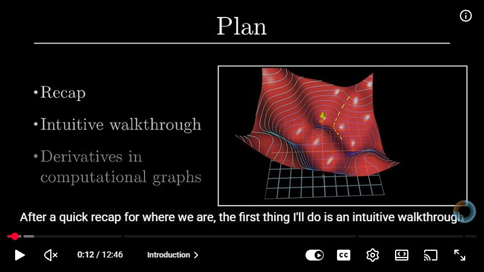
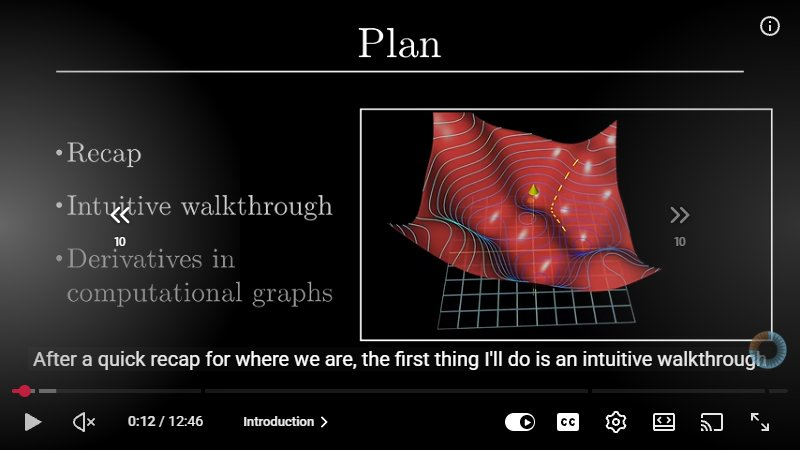

# PiP with Subtitles

A Chrome extension that opens a Picture-in-Picture window **with the site's own subtitles**.

Chrome's built-in Picture-in-Picture shows only the bare video. Most streaming sites draw subtitles as page elements on top
of the video, so they are lost in PiP. This extension uses Document Picture-in-Picture instead: it moves the whole player
(video, subtitles and controls) into the PiP window and puts it back when the window closes.

## Features

- **Subtitles in PiP** - the site's own subtitle styling, language and timing, exactly as on the page.
- **The player's own controls** - seek bar, volume, subtitle and quality menus keep working inside the PiP window.
- **Works on most sites without site-specific code** - the player is found from the `<video>` element; styles are copied.
  Players that re-lay out themselves fill the window; fixed-size players keep their controls at the on-page size while
  the video grows, with their top and center buttons moved to the video's edges and center.
- **Keyboard** - the site's own shortcuts work in the PiP window. Fallback keys when a site has none: `Space`/`K`
  play/pause, `←`/`→` seek 5 s, `↑`/`↓` volume, `M` mute.
- **Move the window by dragging the video** - like Chrome's own PiP. Controls and subtitles keep their clicks.
- **Seek zones** - hovering the video shows the left and right 30% (hidden after 5 s without mouse movement); a click there
  seeks back or forward 10 s.

  

- **Optional: replace site PiP buttons** - a site's own PiP button opens this window instead of Chrome's native PiP.
- **Ad blockers respected** - parts of the player hidden by an ad blocker stay hidden in the PiP window.

## Installation

The extension isn't published yet; load it unpacked:

1. Get the code: clone this repository or download it as a ZIP and unpack it.
2. Open `chrome://extensions` and turn on **Developer mode** (top right).
3. Click **Load unpacked** and select the folder with `manifest.json`.
4. Optional: pin the extension to the toolbar (puzzle icon → pin).

After updating the code, click the reload button on the extension's card. Open tabs don't need a reload, except when the
"Replace site PiP buttons" option is on.

### Shortcut

The suggested shortcut is `Alt+P`. Chrome doesn't assign it if another extension already uses it; set it at
`chrome://extensions/shortcuts` ("Activate the extension").

## Usage

- Press `Alt+P` or click the toolbar icon on a page with a video to open the PiP window; press it again to close it.
  Closing the window returns the player to the page.
- **Replace site PiP buttons**: right-click the toolbar icon and check the option. Reload open tabs afterwards.

## Limitations

- **Players inside embedded frames from other sites** fall back to Chrome's native PiP, without subtitles: browsers only
  allow a Document PiP window from the top-level page.
- **Chrome's own PiP entry points** (the video's right-click menu, the media controls panel, automatic PiP on tab switch)
  can't be redirected; use the shortcut or the site's PiP button with the option on.
- A player that sizes its layout from the main window, not its own box, may look off.

## Project layout

| File | Role |
|---|---|
| `manifest.json` | Extension manifest (Manifest V3). |
| `background.js` | Shortcut/toolbar handling, the site-button option, moving the window on drag. |
| `pip.js` | Finds the player, opens the PiP window, moves the player there, copies styles, chooses the layout. |
| `pip-ui.js` | PiP window extras: dragging the window, seek zones. |
| `main.js` | Runs in the page's own JS: correct click positions for players shrunk in the PiP window. |
| `override.js` | Runs in the page's own JS when the option is on: redirects the site's PiP calls. |
| `toggle.js` | Opens or closes the PiP window after the scripts are injected. |
